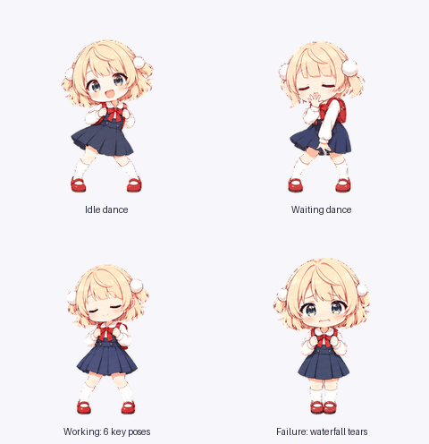

# Shigure Ui pet

A fan-made animated Shigure Ui companion for ChatGPT Pets, with two complete animation sets and options to mix individual states.



## Choose an animation set

| State | Original | More Dancing |
| --- | --- | --- |
| Idle | Calm breathing and blinking | Strap-holding side-to-side dance |
| Waiting | Expectant asking gesture | Hand-to-mouth sway |
| Working | Gentle in-place dance | Arm sweeps, lunge, kick and turn |
| Failed | Disappointed bow | Falls to both knees and cries waterfall tears |

Both sets include movement left and right, waving, jumping, reviewing, and sixteen gaze directions. These shared animations are identical between presets.

- [More Dancing sprite sheet](assets/spritesheet.png)
- [Original sprite sheet](assets/spritesheet-original.png)
- [Full motion video](assets/previews/all-states.mp4)

Pets allows six frames each for idle, waiting and working, and eight for failure. The longer working dance is adapted into six chronological key poses; it cannot play at its full source length in this format.

## Preview

Open `index.html` in a browser, or serve the repository locally:

```sh
python3 -m http.server 8000 --bind 127.0.0.1
```

Open <http://localhost:8000>. Choose **Original** or **More Dancing**, then use the four state selectors to mix your favorites. The preview provides the matching build command. Reduced-motion preferences start playback paused.

## Build and render

Python 3.10 or newer is required; the project was tested with Python 3.12.

```sh
python3 -m venv .venv
source .venv/bin/activate
python -m pip install -r requirements.txt

# Export either complete preset.
python scripts/build.py --preset dance --output build/shigure-ui-dance.png
python scripts/build.py --preset original --output build/shigure-ui-original.png

# Keep the original idle and waiting, with the new working dance and crying.
python scripts/build.py --preset dance --idle original --waiting original --output build/shigure-ui-mix.png

# Render GIFs and an MP4 for the same selection.
python scripts/render_previews.py --preset dance --idle original --waiting original --mp4
```

The per-state switches are `--idle`, `--waiting`, `--working`, and `--failed`; each accepts `original` or `dance`. Every source frame is already registered and transparent. The builder places those pixels into the atlas without resizing or redrawing them.

Ask the Pets plugin to create or update a pet using your chosen PNG. Pets runs its upload validation before saving it. Runtime playback timing is controlled by Pets; the repository records preview timings in `pet.json`.

## Verify

```sh
python scripts/build.py --preset dance --check
python scripts/build.py --preset original --check
python scripts/validate.py build/shigure-ui-mix.png
python -m unittest discover -s tests -v
```

The checks verify exact reconstruction of both published presets, mixed-state selection, frame geometry, transparency, occupied cells, and unused cells. They supplement the Pets upload checks; semantic and visual animation quality still need review after artwork changes.

The [GitHub Actions template](docs/github-actions.example.yml) runs these checks and renders an MP4. To enable it, copy it to `.github/workflows/validate.yml` and push with a GitHub login that has workflow permission. The publishing login could push the project but could not install Actions workflows.

## Project files

- `assets/frames/`: approved RGBA frames, including all original alternatives.
- `assets/spritesheet*.png`: both complete, validated v2 sheets.
- `assets/previews/`: motion previews and contact sheets.
- `source/`: canonical identity artwork and generated animation strips.
- `prompts/`: final image-generation prompts for the four dance-update states.
- `scripts/`: portable build, integrity-check and preview tools.
- `pet.json`: layout, timing, preset and frame-source configuration.
- [Format details](docs/animation-format.md), [validation record](docs/validation.md), and [reference credits](ATTRIBUTION.md).

The artwork was created with built-in image generation and processed through the Pets creation workflow. These portable scripts rebuild the approved cells and require only the Python dependencies listed above.
